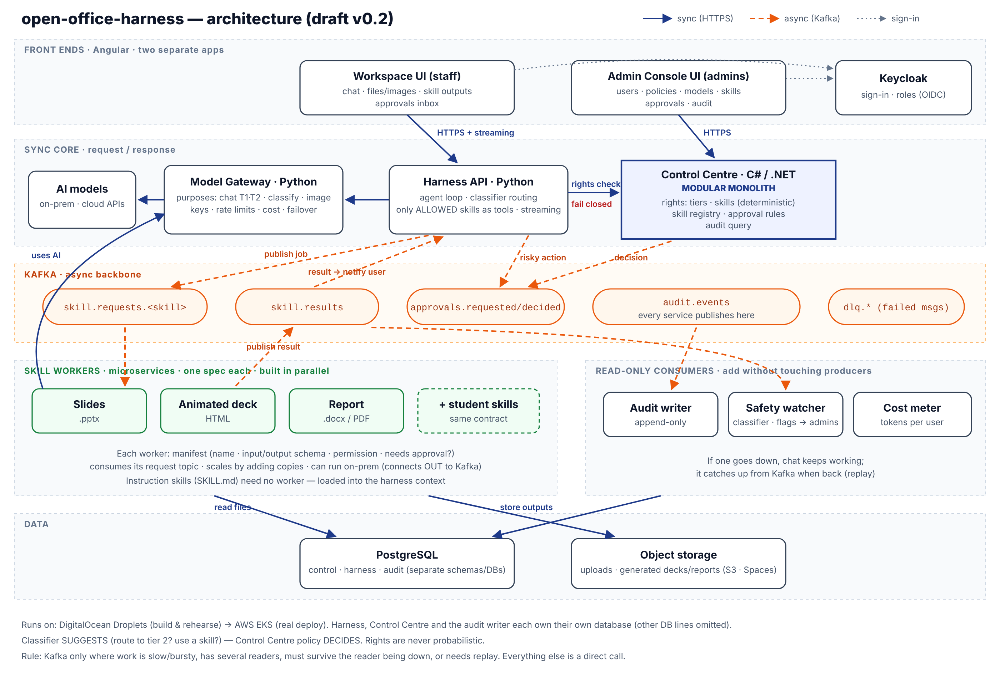

# open-office-harness architecture

Stage 3 adds asynchronous Slides jobs, the audit writer, cost meter and safety
watcher, plus Overview, Approvals, People & rights and Audit in the Admin Console.
The Workspace keeps direct streamed chat and adds live job cards and skill requests.
Classifier routing is added separately in phase 2 after the pre-routing tag.
The fixed stage specifications and global rules take precedence over the planning
image: deployment uses plain Kubernetes manifests, and each service has its own
database rather than shared tables.

| Module | Owns | Never does |
|---|---|---|
| Workspace (Angular 22) | Sign-in, access-state screens, allowed tiers, conversations, streamed chat, Jobs, authenticated downloads and skill requests | Contact Kafka, models or the Control Centre database |
| Admin Console (Angular 22) | Overview, Approvals, People & rights, Models & tiers, Audit and encrypted key entry | Contact the Harness directly |
| Control Centre (.NET 10 modular monolith) | Deterministic rights, access approvals, model and skill registries, encrypted provider keys, approval rules, its own append-only change log and audit query | Call AI outside the Gateway's pinned test call |
| Harness API (Python 3.14) | Conversations, last 20 completed messages, rights checks, allowed tools and streaming, job ownership and tool loop; routing in phase 2 | Decide rights or store secrets |
| Model Gateway (Python 3.14) | Purpose/tier routing, rate limits, cost and failover; uses per-call keys read from the Control Centre, which holds them encrypted | Know who the user is beyond user_id for cost |
| Skill workers (Python 3.14) | One skill each; requests, files and results | Check rights after a job is published |
| Audit writer | Append-only audit store | Change upstream business state or publish jobs |
| Safety watcher | Read events and raise approval flags | Publish skill jobs or grant rights |
| Cost meter | Read usage events and write its own store | Change upstream business state |
| Platform | Keycloak identity, Kafka topics and ACLs, PostgreSQL, private storage, Kubernetes | Business logic |
| Instruction skills | Know-how loaded as context from SKILL.md | Run worker code |

## Stage 4 phase 1: tracing and replay

Jaeger 2.23.0 runs as one internal Deployment in `ooh-platform`. Its Service
exposes OTLP HTTP on 4318 and the query API on 16686; probes use `/status` on
13133 directly on the pod. No Ingress is created. Memory storage retains at
most 20,000 traces, with a memory limiter before batching; a restart loses
traces, while the append-only audit trail remains permanent.

Every service exports traces asynchronously using HTTP/protobuf; an empty
`OTEL_EXPORTER_OTLP_ENDPOINT` leaves tracing off. Health requests are excluded.
Only the fixed span attribute allow-list is exported, without events or exception
text. No database spans or provider HTTP auto-instrumentation are enabled.
Ingress requests start fresh traces when `X-Forwarded-For` is present; internal
HTTP requests retain their parent context. Kafka producers carry W3C
`traceparent` and optional `tracestate` headers, outside the unchanged envelope;
consumer spans continue that context. Audit producers include a valid `trace_id`
when available. Audit writer stores it and supports filtering by it.

Admin Console reads a reduced trace timeline through the admin-only Control
Centre route `/api/admin/traces/{trace_id}`. The Control Centre queries Jaeger
internally; neither the browser nor another sign-in accesses Jaeger. Missing or
unavailable traces do not prevent reading Audit.

Failed messages lets an admin replay a stored original envelope unchanged to
its source topic, using the same event ID and correlation ID. Control Centre
waits for Kafka delivery, records an append-only replay outcome and audits
`dead_letter.replayed`. A replay publishes under the admin request's trace.
Non-JSON originals and ID-only chat dead letters are refused. Already handled
events are ignored by consumers. A Slides failure with `worker_gave_up` can
complete after replay; other final job states remain final. Worker result and
audit IDs include status, so failed and completed results are distinct while
duplicates of a completed request reuse the file and result ID. Workspace updates
the failed card on completion or reload.

`78-check-stage-4.sh` exercises HTTP and Kafka trace continuity, raw-span privacy,
replay and retained files. It creates direct Kafka jobs for replay checks, with
no Harness job row; browser acceptance and Harness tests cover card recovery.
Its chat check reads the completed stream and then the saved conversation's
newest user message ID as correlation ID. `79-demo.sh` provides worker-down,
duplicate and dead-letter demonstrations. Both scripts restore stopped services
on exit; `restore` recovers manifest replica counts without a check client.
Workspace stores a validated saved-conversation UUID in session storage before
sign-in, consumes it once after sign-in, and scrolls wide Markdown tables without
breaking words.

## Agreements between modules

- [Identity](../contracts/identity.md): users authenticate through Keycloak;
  every service validates its own token. Service calls use service accounts.
- [Control Centre HTTP](../contracts/http/control-centre.openapi.yaml): rights,
  allowed manifests and purpose/tier assignments. No reply to a rights check means
  not allowed. The optional rights-list cache starts at 30 seconds; it must not
  turn an unavailable rights decision into permission for a new job.
- [Gateway HTTP](../contracts/http/model-gateway.openapi.yaml): AI calls by
  purpose and tier, plus classifier scores. Scores suggest; fixed policy decides.
  A tier is a positive integer field on a chat registry entry; creating one also
  creates its right. Registry assignments and credentials are runtime data.
- [Harness HTTP](../contracts/http/harness-api.openapi.yaml): conversations,
  message streaming, job updates and downloads by job ID. Uploads stay unavailable.
- [Events](../contracts/events/envelope.schema.json): all business-event records
  share an envelope; the Kafka key is correlation_id. Consumers ignore duplicate event_id
  values, retry a fixed configured number of times, then publish to dlq.<topic>.
  Retry counts are specified when consumers are built. The ooh.smoke
  platform-check topic is free-form with no schema or envelope.
  Topic retention and
  partitions are fixed in [topics.yaml](../contracts/events/topics.yaml).
- [Skills](../contracts/skills/manifest.schema.json): a manifest declares the
  permission, approval need and input/output shapes. Only allowed skills appear
  as model tools. Slides produces a PowerPoint file.
- [Storage](../contracts/storage.md): the retained ooh-files volume holds private file keys;
  downloads use a bearer token and the Harness job ownership check.

## Flows

**Normal skill (Stage 3):** Workspace sends a message to the Harness; the chat model calls an allowed
skill tool. The Harness checks the skill right with the Control Centre, validates
arguments, records a job, audits the right check and publishes skill.requested
to skill.requests.slides. The chat shows a Queued card and continues immediately.
The tool result goes back to the same pinned model entry with its reasoning
state unchanged, for at most two tool rounds. The worker writes an output to storage
and publishes skill.result. The Harness sends job.completed to the Workspace.

**Approval (Stage 3):** when a skill manifest needs per-job approval, the Harness publishes approval.requested first. Slides does not need per-job approval.
The Control Centre handles the admin's decision through the Admin Console and
publishes approval.decided. Only an approved request with valid rights proceeds;
a rejected request never becomes a skill job. The UI shows awaiting approval.

**Request access (Stage 2):** Keycloak owns registration and password entry.
Its email-as-username policy, English Request access link and managed user profile
collect names, work email, organisation and optional reason. Only organisation
and reason have extra access-token mappers on the Workspace client; ordinary
profile scopes supply name, email and given name. Email verification and reset
mail are off, while the Account Console remains reachable. Script 35 updates
existing realm settings, texts and the two profile attributes, preserves all
other attributes and unmanaged policy, and can close registration with
`--registration off` (default/no flag or `--registration on` opens it).

The Harness observes each verified user's exact sub and trimmed, bounded token
claims in the Control Centre before returning `/api/me`. A verified admin role
is passed as `is_admin`. The Control Centre keeps pending, approved and rejected
access rows; at 100 waiting rows it creates nothing and returns closed. The
Workspace sends no conversation requests unless `/api/me.access` is approved.
Pending, rejected and closed people see only their state message and Sign out;
an observe failure produces a red notice and fails closed.

Only approved people receive rights or skills, including Everyone grants.
Approval with a chosen existing tier and adding a person by user ID create the
user's grant and approve access in one transaction. Admins are approved
when observed. Pre-migration people and active user grants are backfilled;
Everyone-only users must request approval once. Reject or Revoke denies access;
rejected requests can be approved later. Access-request lists/counts hide
stage-check- users and mark emails unverified. Pending profile changes can update
request details, but cannot change approved/rejected decisions. Access audit
records contain only user ID, status, decider and approved tier, never names,
emails, organisation, reason, passwords or tokens. Rows have deleted_at and
no-DELETE/TRUNCATE protections. No external admin notification or mail service
is introduced.

Deployment for this change is 61 → 67 → 35 → 68 → 69 → 62 → 70, so approval
and observation exist before registrations open. Check 70 reads the registration
form and observes only the fixed stage-check-access user; it creates no Keycloak
person. Everyone-gate checks belong to 62.

**Chat (Stage 2):** both apps sign in through Keycloak with code + PKCE S256
and session storage. Each reads its issuer, client ID and same-host API path from
`/config.json`. Workspace shows only allowed chat tiers and the user's ID with a
copy button for grants. The chat model picker uses the tier's main title and
shows a Thinking switch only when that main entry supports it. The browser
remembers the choice per tier and forwards it with the question. Completion
metadata identifies the actual answering model and reports when thinking-off
was requested but unsupported, including backup/fallback answers. This notice
is live metadata rather than stored history. Request another model opens a
small panel using requestable_tiers from the Harness. Requests go through the
Harness as the verified person; the Control Centre enforces approved access,
excludes granted tiers and tier 99, prevents duplicate pending requests, caps
pending requests at 20 and enforces seven days after rejection before retry.
The sign-in card offers Request access through its configured OIDC client with
prompt=create, opening Keycloak registration with the same code + PKCE flow.
Its greeting uses the browser's local hour. Reasons are plain text and never logged. It sends a question to its own Harness API. The Harness
checks the conversation owner and asks the Control Centre for `chat.tier` with
the selected tier. Missing policy fails closed. A refused tier is a 403 with a
plain message; it is not sent to a model. The browser reads the POST answer using fetch and SSE. User messages stay
plain text. Assistant messages render Markdown and LaTeX maths while streaming
and after completion, at most ten full renders per second while streaming.
Raw HTML remains inert text and outside images are suppressed. DOMPurify first
sanitizes Markdown with the forbidden-tag policy and HTTP/HTTPS/mailto-only
links. KaTeX uses `throwOnError: false` and `trust: false`, and its generated
HTML/MathML/SVG is sanitized separately. Code remains literal and incomplete
maths stays text. CSS, fonts and licences ship locally. Every message shows
browser-local date/time and a Copy button for original source; code blocks have
a separate copy control. Stored timestamps survive reload, while new messages
use send/completion times. Optional provider thinking arrives in separate
thinking events and is concatenated on the assistant message; the Harness
stores it in its own database and includes it in conversation history, never
in subsequent model context. Workspace displays it as plain text in a collapsed
Thinking disclosure above the answer, with a live Thinking… label while the
answer streams. Its own copy control copies thinking; the message copy remains
answer-only. Thinking text is never logged or passed through the Markdown
renderer.

The Harness sends the last 20 completed, nonempty conversation messages,
starting with a user message, then the new question. Part B's HA_SYSTEM_PROMPT
adds the configured reply-language system message. After the first completed
assistant answer, a separate title call may generate a short title using the
answering tier and its own system message, with a 20-second limit. Completed
enables the Workspace composer immediately; an optional later title event
updates only its conversation's heading/list without changing updated_at.
Failure keeps the default title and completed answer.
Only allowed skills are offered as tools. A tool call starts an asynchronous
job and returns its ID to the model. If the queue fails, the job is failed and
the person sees a plain message. A later model failure leaves the job card visible. Conversations
belong to the Harness database, and messages cannot be updated or deleted.

The Gateway resolves purpose and tier from the Control Centre registry on
internal port 8081. It tries main entries before backup entries, then priority
and creation time. A failure before output may try the next entry; a failure
after output ends the stream. Per-entry, per-user rate limits use the last 60
seconds of completed/failed usage. Per-entry budgets use the UTC day's cost.
When every entry is over budget, the Harness can fall back to the lowest allowed
tier and includes a note. Usage and calculated cost live in the Gateway's own
append-only database. In Stage 3 the Gateway publishes model.call/model.classify
audit events including tokens and cost, without text. It reports model health
changes to the Control Centre on internal port 8081.

**Test connection (Stage 2):** the Control Centre calls AI only through the
Gateway's pinned test call. An admin presses Test beside a model entry with a
saved key. The public admin route sends that entry's purpose, tier and ID to
`/v1/call` with `stream: false`, no tools, a user ID starting `admin-test-` and
exactly one user message: `Reply with the single word OK.` The Gateway refuses
any other Control Centre call. Stage 3 adds its pinned /v1/classify test with
text "This is a connection test." and question {"test":"Is this a connection test?"}. The Control Centre's
service token carries the Gateway audience through an access-token-only realm
mapper. Ordinary Harness calls keep their existing rules.

The call is paid and counts toward the entry's daily budget and rate limit.
The console shows timing, a short plain-text reply, tokens and cost, or a plain
failure reason and a redacted provider message. Keys never reach the browser.
The Control Centre audits `model.tested` with entry ID, result, reason and duration;
it logs neither reply nor provider message. Script 71 copies the client secret
once and refuses a changed existing value. Without service credentials, the
Control Centre starts normally and the test returns a setup failure.

**Tier routing (Stage 3):** a classifier score may suggest a higher tier. The
Harness will check `chat.tier` before using it. The planned classifier fallback
to a separately allowed lower tier with a note belongs to that routing flow;
it does not override Stage 2's refusal of an explicitly requested forbidden tier.
Unavailable policy always fails closed.

**Worker down:** Kafka retains queued jobs. The worker catches up when it returns,
with duplicate-event handling. Chat remains a direct HTTP stream and continues
without waiting for workers or read-only consumers.

## Data and deployment

Each service owns its own PostgreSQL database. The Harness owns conversations;
the Control Centre owns policy, registries and its own append-only change log.
It saves each change, its audit row and outgoing events in one database
transaction; an outbox publisher sends the events to Kafka. The Audit writer
(Stage 3) keeps the full trail across services by consuming audit.events.
Other modules use contracts and never query those tables directly. Business
records use deleted_at; audit records are append-only with database enforcement.
Stage 0 creates Keycloak's database; Stage 1 adds the Control Centre database,
and Stage 2 adds separate Harness and Gateway databases. All stored times are UTC; the initial
display setting is Asia/Kuala_Lumpur. User-facing text is English.

Services, consumers, the Slides worker and both apps run in ooh-apps.

The rehearsal runs on the DigitalOcean Droplet harness: single-server k3s,
Traefik ingress, cert-manager, Strimzi Kafka, CloudNativePG PostgreSQL and
Keycloak in ooh-platform. The ooh-files PVC (20Gi, local-path, PV Retain) holds private
files. The worker mounts /files read-write and atomically renames completed
outputs/slides/<job-id>/<safe-title>.pptx files; the Harness mounts /files
read-only. Downloads use GET /api/jobs/{job_id}/file with a bearer token, check
the completed job belongs to that user and resolve the path under /files/outputs/.
There are no signed links or file deletions. Workspace and its /api share harness.faysalaziz.com; Admin Console and
its /api share admin.faysalaziz.com; Keycloak uses auth.faysalaziz.com. Gateway,
Kafka and PostgreSQL have no public hostname.

Stage 6 moves to AWS EKS with the same manifests and different values, and S3
storage. AWS infrastructure uses Terraform; Aziz performs Stage 6 deployments. Secrets
are Kubernetes Secrets created by setup scripts, never repository values.
Admins type provider keys once in the Admin Console. The Control Centre stores
them encrypted with AES-256-GCM using a Kubernetes encryption-key Secret and the
entry ID as associated data. Admin responses expose only `has_key`. Only the
Gateway service account may retrieve a decrypted key, on internal port 8081;
registry and key routes return 404 on public port 8080. Keys follow their endpoint
and connection type: changing either clears the saved key unless replaced.
The Gateway caches registry data for 30 seconds and keys for 60 seconds.
Its three adapters implement the connection formats chosen per registry entry;
provider addresses, models and prices are registry data, never compiled settings.
Kafka is used for slow work, fan-out, outage survival and replay; chat and policy
checks use direct HTTP. Stage 2 deploy/check scripts run in Claude's shell tile while Aziz watches;
Aziz retains sudo, browser sign-ins, package visibility switches and acceptance.

## Stage 3 events, identity and operational checks

After storing each nonempty user/completed assistant message, the Harness
publishes chat.message (first 20,000 characters) to chat.messages. Correlation
is the user message ID for that turn. Skill jobs get their own request ID,
used by worker Gateway calls, rights audits and results. Jobs and chat cards
show the first eight characters and copy the complete ID. GET /api/events
supplies the user's job changes; a reconnect reloads GET /api/jobs.

The audit writer owns auditwriter.trail; the cost meter owns costmeter.model_costs.
Both enforce append-only rows and unique event IDs. The safety watcher has no
database: it classifies chat text and completed skill summaries through the
Gateway. Every score is audited. A configured threshold may raise a safety.flag
approval with a 300-character excerpt in the approvals table, never in audit
rows or logs. Clear rejects the flag; Confirm problem approves it. Classifier
404/429/503 outcomes are audited without retry or DLQ. Chat DLQs contain IDs
only. Other processing failures retry three times with waits 1, 5, 15 seconds;
schema failures go straight to the relevant DLQ. The Control Centre consumes
approvals.requested and all six DLQs in its one control-centre group.

Overview obtains distinct active people and action counts from the audit writer,
cost from the cost meter and admission counts from its own access rows. Missing
remote figures are null. Service health refreshes every 30 seconds. Skill rights
are requested once and granted by an admin; job approval remains a separate
manifest switch. Service accounts stay out of People & rights and Approvals.

The login theme ooh extends keycloak.v2 using CSS, messages and theme.properties
in a ConfigMap mounted at /opt/keycloak/themes/ooh through the operator's
unsupported.podTemplate. It uses design tokens and system fonts, with no custom
image. Realm display name is Open Office Harness. Admin device sign-in is off.
The new worker/watcher clients have Gateway audiences; only the Control Centre
has the custom audit-writer/cost-meter audiences.

Checks 62, 73 and 77 share one PID lock and temporary ooh-stage-check admin
client. Each enable/disable rotates its secret, every exit tries to disable it,
and normal completion verifies disabled status before releasing the lock.
Check 40 catches an enabled client without a live check. Secrets/tokens reach
HTTP tools through standard input; they are never stored or printed. Check 77
uses short-lived pods for Kafka, read-only PowerPoint inspection and a
harness_app query returning one other-user job ID. Its tool check makes a
first call, a pinned reasoning/tool-result follow-up, then a new user question
with the earlier tool turn still in history. Paid live checks belong to the
merged-stage deployment, not the builders' local verification.
