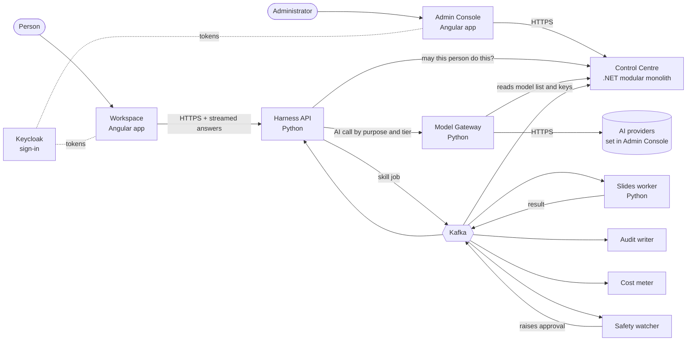
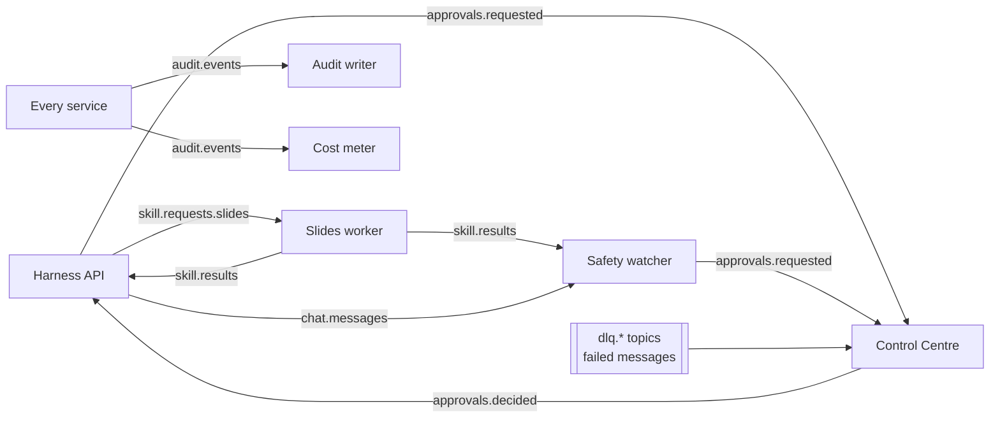
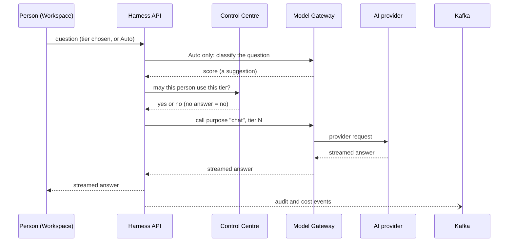
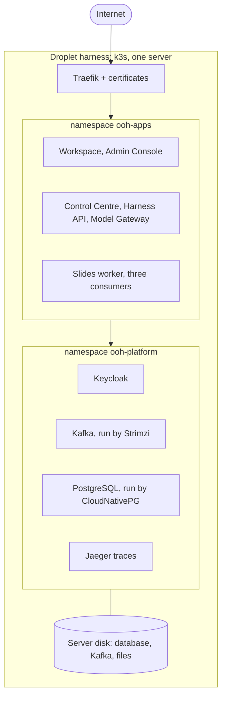
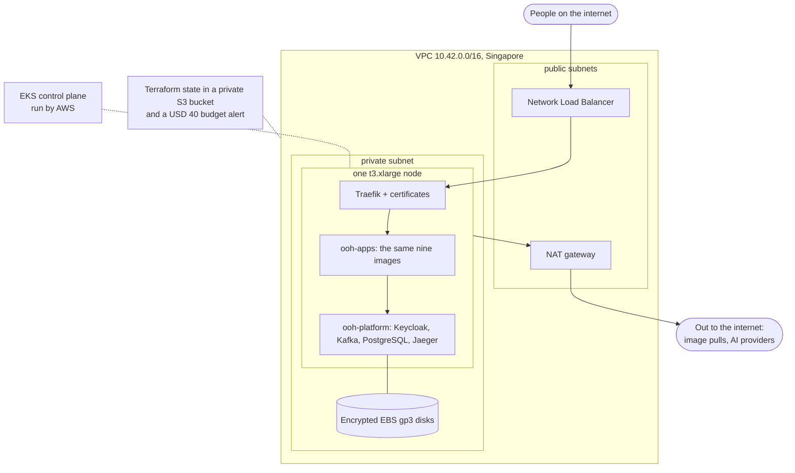
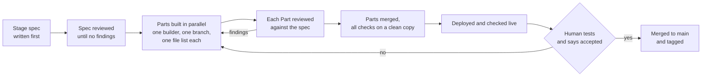

# open-office-harness: start here

This page explains the whole project in one place: what it is, how the parts
fit, where it runs, how to build it on each target, and how it was built.
Every detail lives in a deeper file; this page tells you which one.

Last updated: 15 Nov 2026 (Stage 4 phase 2 accepted, tag `eks-ready`; the AWS
copy has been destroyed again, the Droplet is the running system).

## 1. What it is

An office AI harness: people chat with AI models and ask for skills (the first
skill makes PowerPoint decks), while an administrator decides who may use what,
approves requests, and can see every action afterwards.

Three rules shape everything:

- **Fixed rules decide rights, never an AI.** If the rights service does not
  answer, the answer is "not allowed".
- **Nothing about AI providers is in the code.** Models, tiers, addresses,
  prices and keys are data an administrator types into the Admin Console.
- **Nothing is deleted.** Business rows get a `deleted_at` time; the audit
  trail is append-only, enforced by the database.

Licence: AGPL-3.0.

## 2. The parts



| Part | Folder | What it owns | What it never does |
|---|---|---|---|
| Workspace | `apps/workspace` | Sign-in, chat, job cards, downloads, asking for access | Talk to Kafka, models or the Control Centre |
| Admin Console | `apps/admin-console` | Overview, Approvals, People & rights, Models & tiers, Audit, Failed messages | Talk to the Harness |
| Control Centre | `services/control-centre` | Rights, approvals, model and skill lists, encrypted provider keys | Call AI (except one fixed test call) |
| Harness API | `services/harness-api` | Conversations, rights checks, skill jobs, routing | Decide rights or store secrets |
| Model Gateway | `services/model-gateway` | Picking the model for a purpose and tier, rate limits, cost, failover | Know who the person is beyond an ID for cost |
| Slides worker | `workers/slides` | Making the PowerPoint file | Check rights after a job is published |
| Audit writer | `consumers/audit-writer` | The permanent audit trail | Change anything else |
| Cost meter | `consumers/cost-meter` | Cost per model call | Change anything else |
| Safety watcher | `consumers/safety-watcher` | Scoring messages, raising a flag for an administrator | Grant rights or start jobs |

Each service has its own PostgreSQL database. Nobody reads another service's
tables; parts talk only through the agreements in [`contracts/`](../contracts/README.md).

### When Kafka is used, and when it is not

Kafka is used only where it solves a real problem: slow work, fan-out to
several readers, surviving a service being down, and replay. Chat streaming
and rights checks are direct HTTP calls.



Agents never talk to each other directly, only through topics. A message that
keeps failing goes to a `dlq.` topic; an administrator can replay it from the
Failed messages screen. Topic list, partitions and retention:
[`contracts/events/topics.yaml`](../contracts/events/topics.yaml).

### One chat question, step by step



The classifier only suggests a tier; the fixed rights check still decides.
The routing rule and its measured threshold: [`docs/routing/README.md`](routing/README.md).

## 3. Where it runs: two targets, one set of files

The same manifests, the same nine container images and the same install
scripts deploy either target. `OOH_TARGET=do` or `OOH_TARGET=aws` chooses; each
script prints its target on its first line and refuses to touch the wrong cluster.
Only the values differ: [`deploy/values/do.env`](../deploy/values/do.env) and
[`deploy/values/aws.env`](../deploy/values/aws.env).

| | DigitalOcean Droplet (`do`) | AWS EKS copy (`aws`) |
|---|---|---|
| Role | The running class system | A temporary copy to prove the move; destroyed after checks |
| Kubernetes | k3s on one server | EKS 1.36, cluster `ooh-aws`, Singapore |
| Built by | `install/01-server-setup.sh` (sudo, by hand) | Terraform, three roots in `infra/terraform/aws/` |
| Machines | One Droplet | One `t3.xlarge` node in a private subnet |
| Front door | Traefik on the server's public address | AWS Network Load Balancer, then Traefik |
| Disks | `local-path`, kept on delete | Encrypted EBS `gp3` (`ooh-gp3`), deleted with the copy |
| Web names | `harness.`, `admin.`, `auth.faysalaziz.com` | `harness.aws.`, `admin.aws.`, `auth.aws.faysalaziz.com` |
| Kafka, PostgreSQL, Keycloak | Inside Kubernetes | Inside Kubernetes (same operators) |
| Cost | The Droplet's monthly price | About USD 0.42 an hour while it exists |

### Droplet



### AWS



What AWS adds that the Droplet does not need: a private network with a NAT
gateway, a managed load balancer (the AWS Load Balancer Controller creates it),
a disk driver with its own permissions (Pod Identity), and Terraform state.
The spec with every decision and price: [`docs/specs/stage-4b-aws.md`](specs/stage-4b-aws.md).

## 4. How to build it

The README is the step-by-step guide; every command there says where to type
it, what it does, and what a good result looks like. Read it in this order:

| You want to | Read |
|---|---|
| Build the Droplet system from nothing | README, from the bottom up: Stage 0, Stage 1, Stage 2, Stage 3, Stage 4 |
| Build the AWS copy | README, "AWS copy" section, steps 1 to 12 |
| Remove the AWS copy | README, "AWS copy" step 11, and section 6 below |
| Know what a STOP or FAIL line means | The "STOP and FAIL help" table of that stage in the README |
| Know what is built and what passed | [`docs/STATUS.md`](STATUS.md) |

The scripts in `install/` are numbered in the order they run:

| Numbers | What they do |
|---|---|
| `00`, `01` | Check the server; first server setup (sudo) |
| `10` to `50` | Operators, secrets, platform (Kafka, PostgreSQL, Keycloak), realm sync, platform check, first administrator |
| `59` to `71` | Control Centre, Model Gateway, Harness API, Workspace, Admin Console: setup, deploy, checks |
| `72` to `77` | Slides worker and the three consumers; Stage 3 check |
| `78`, `79` | Stage 4 check (traces, replay); the three class demos |
| `80` to `86` | AWS only: tools, state bucket and budget, cluster, sign-in, DNS check, destroy, AWS check |

Container images are built by GitHub Actions (`.github/workflows/`), one
workflow per image, and published as `ghcr.io/frozenfussion/ooh-<name>`, tagged
with the first 12 characters of the commit.

Secrets are never in this repository. Setup scripts create them as Kubernetes
Secrets; AI provider keys are typed into the Admin Console and stored encrypted.

## 5. Versions you can check out

| Tag | What works at that point |
|---|---|
| `spine-v0.0` | Platform only: Kubernetes, certificates, Kafka, PostgreSQL, Keycloak |
| `spine-v0.1` | Control Centre: rights and the change log |
| `spine-v0.2` | Chat: Model Gateway, Harness API, Workspace, Admin Console models screen |
| `pre-routing` | Skills on Kafka (Slides), audit, cost, safety, all admin screens; no automatic tier choice yet |
| `spine-v0.3` | The same plus classifier routing ("Auto") |
| `class-start` | Tracing, replay of failed messages, the three failure demos |
| `eks-ready` | The same system also deploys to AWS EKS with Terraform |

`stage-N-base` tags mark the commit each stage's builders started from.

## 6. Known issues (15 Nov 2026)

These were found when the AWS copy was destroyed for real. None affects the
Droplet. They wait for a builder fix round and review.

| Issue | What you see | What to do until it is fixed |
|---|---|---|
| The destroy script does not remove Kafka's node pool | `install/85-aws-destroy.sh` stops with `STOP: pods still mount data disks` | Before the destroy, run `kubectl --kubeconfig="$HOME/.kube/ooh-aws.config" -n ooh-platform delete kafkanodepool dual-role`, then run the destroy |
| The AWS sign-in code is about 2,500 characters and some embedded browsers block the page's copy button | `Failed to decode the verification code`, or `State parameter ... does not match` when an older code is pasted | Start a new sign-in for every attempt and paste only the code from that page; each code belongs to one sign-in. If the page's copy button reports a failure, nothing new reached the clipboard, so what you paste is an older copy |
| An AWS sign-in once ended after about three minutes (cause not known) | `ExpiredTokenException` in the middle of a script | Run `install/83-aws-login.sh` again and rerun the stopped script; the scripts are safe to rerun |

Measured on 15 Nov 2026: the destroy took 20 minutes from typing `yes` to
`DONE`, and its last line was `PASS: no AWS copy resources remain`.

## 7. How it was built

The whole system was built by AI agents under one person's direction, one
stage at a time. The rules they follow are in the repository itself.



| Role | Who | Does |
|---|---|---|
| Owner | The maintainer | Every decision; every sudo line and password; tests and accepts each stage |
| Orchestrator | Claude | Writes the stage specs, splits them into Parts, keeps `docs/STATUS.md` in step |
| Builders | Codex, one window per Part | Build exactly what their Part lists, on their own branch |
| Reviewer | Opus, in Claude Code | Reviews each Part against its spec with a fixed checklist; findings only |

The rule that makes parallel work safe: a Part changes only the files its spec
lists, and no two Parts list the same file.

| File | What it is |
|---|---|
| [`docs/specs/00-GLOBAL-RULES.md`](specs/00-GLOBAL-RULES.md) | Roles, what agents must never do, fixed decisions, the build flow, the report format, the review checklist |
| `docs/specs/stage-*.md` | One spec per stage: the owner's words and decisions, the base commit, exact files per Part, and the "Done when" list |
| `AGENTS.md`, `CLAUDE.md` | The same rules, in the files each agent reads first |
| [`docs/STATUS.md`](STATUS.md) | What is built, what passed, what is open |
| [`docs/ARCHITECTURE.md`](ARCHITECTURE.md) | The parts and their flows in full detail |

## 8. Repository map

```
open-office-harness/
  README.md              step-by-step guide for every stage and for AWS
  docs/
    OVERVIEW.md          this page
    ARCHITECTURE.md      parts, agreements and flows in detail
    STATUS.md            what is built, checked and open
    specs/               global rules and one spec per stage
    routing/             the routing rule and its measured threshold
    design/              screen designs the apps were built from
  contracts/             agreements between parts: HTTP, events, skills, storage, identity
  apps/                  workspace, admin-console, design-system
  services/              control-centre (C#), harness-api, model-gateway (Python)
  workers/               slides
  consumers/             audit-writer, cost-meter, safety-watcher
  deploy/
    platform/            Kafka, PostgreSQL, Keycloak, certificates, tracing
    apps/                one folder of manifests per service
    values/              do.env and aws.env: the only difference between targets
  infra/terraform/aws/   bootstrap, cluster, addons
  install/               numbered scripts: setup, deploy, check, AWS
  .github/workflows/     one image build per service
```
